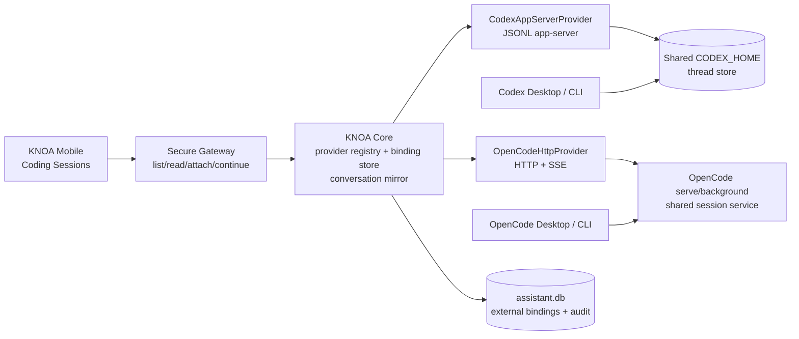

# KNOA 外部 Coding Session 桥接设计

> 类型: 需求设计
> 来源: ROBOTPLAN-CODING-SESSION-BRIDGE
> 需求文档: 本次用户需求（2026-10-28 对话）
> 需求结论: KNOA 手机端能够列出、查看、绑定并继续同一台机器上的 Codex 与 OpenCode 外部会话，外部客户端正在执行时保持只读。
> 架构结论: KNOA 通过统一 CodingSessionProvider 适配层连接 Codex app-server 与 OpenCode HTTP/SSE 服务，使用持久化外部会话绑定将手机端 KNOA 对话映射到外部会话。
> 交付范围: KNOA Core、Secure Gateway、knoa-mobile、Codex app-server provider、OpenCode v2 HTTP provider、会话绑定持久化、事件与并发控制
> 首要风险: 外部客户端与 KNOA 同时写入同一会话会破坏上下文，因此所有写入必须经过外部 provider 的并发控制并将冲突映射为只读状态。
> 创建时间: 2026-10-28
> 更新时间: 2026-10-30
> 代码位置: src/knoa_codex_agent, src/knoa_platform/agent_runtime, src/knoa_platform/service, src/knoa_platform/gateway, apps/knoa-mobile

## 需求

本需求交付一个可从手机继续桌面 Codex、Codex CLI 和 OpenCode 会话的 KNOA Coding Sessions 工作流。当前 KNOA 的 agent 选择仅在新会话生效，已有消息后会锁定 agent；当前 Codex 配置使用 `exec_json` 和独立 `CODEX_HOME`，因此无法发现桌面 Codex 会话。运行证据显示，Codex 0.165.0 的本地协议包含 `thread/list`、`thread/read`、`thread/turns/list`、`thread/items/list`、`thread/resume`、`turn/start` 和 `turn/interrupt`；本机 OpenCode 2.1.4 提供 `/api/session`、`/api/session/{id}`、`/api/session/{id}/message`、`/api/session/{id}/prompt`、`/api/session/{id}/interrupt` 和 `/api/event`。

用户从手机进入 Coding Sessions 后能够按 provider、项目目录和更新时间浏览外部会话，查看标题、工作目录、最新消息、运行状态和只读原因。用户明确绑定一个外部会话后，KNOA 创建或复用一个本地对话壳；手机输入通过原外部会话继续执行，外部会话的事件和最终回复镜像到 KNOA 时间线。已被桌面或 CLI 执行的会话允许查看和接收进度，但拒绝并发写入；外部会话完成、空闲或中断后允许继续。

本需求保留现有普通 KNOA 对话和本地 agent 运行方式，不把外部会话直接导入为新的 LLM 上下文，不直接读写 Codex 或 OpenCode SQLite，不绕过 provider 的权限、审批和会话锁。第一版支持同一台主机上的本地服务；跨主机访问需要后续部署远程 provider 网关，不属于本次范围。

## 架构设计

最终采用 KNOA Gateway 作为手机端唯一入口、Core 作为绑定和审计状态所有者、provider adapter 作为外部协议边界的架构。外部 Codex app-server 和 OpenCode serve/background service 保留会话、运行状态、权限和并发锁的权威性。

| 组件 | 职责 | 状态所有者 | 接口 |
|---|---|---|---|
| `CodingSessionProvider` | 定义列举、读取、事件、继续、中断和能力探测 | provider 实现外部状态映射 | Python internal protocol |
| `CodexAppServerProvider` | 连接共享 `codex app-server`，映射 Thread/Turn/Item | Codex app-server | JSONL protocol |
| `OpenCodeHttpProvider` | 连接共享 OpenCode 服务，映射 Session/Message/Event | OpenCode service | HTTP v2 + SSE |
| Core binding store | 保存 principal、KNOA session 与外部 session 的绑定和版本 | KNOA Core | Core API v1 |
| Secure Gateway | 鉴权、限流、移动端 JSON API 和流式事件 | KNOA Gateway | `/v1/coding/sessions/*` |
| Mobile Coding Sessions | 列表、详情、绑定、继续、只读和冲突呈现 | UI 状态由 provider 刷新 | Gateway REST/SSE |

## 详细设计

核心实现建立统一外部会话模型，并让 provider 只负责协议转换。外部会话至少包含 `provider`、`external_session_id`、`title`、`directory`、`state`、`updated_at`、`latest_user_message`、`latest_assistant_message`、`read_only` 和 `capabilities`。状态统一为 `idle`、`running`、`interrupted`、`failed`、`unknown`；provider 的原始状态保留在诊断字段中。

KNOA 新增 `coding_session_bindings` 持久化表，主键为 `(principal_id, provider, external_session_id)`，并对 `(principal_id, knoa_session_handle)` 建唯一约束。表字段包括 `binding_id`、`principal_id`、`knoa_session_handle`、`provider`、`external_session_id`、`directory`、`binding_state`、`last_seen_revision`、`created_at` 和 `updated_at`。绑定操作使用幂等键；同一个 KNOA 对话不能绑定两个活动外部会话，同一个外部会话不能被同一 principal 的两个 KNOA 对话同时接管。

Secure Gateway 提供以下版本化接口：

- `GET /v1/coding/sessions?provider=&directory=&search=&state=&limit=&cursor=`：并行查询已配置 provider，返回统一分页结果。
- `GET /v1/coding/sessions/{provider}/{external_id}`：返回会话详情、最近消息和可用能力。
- `GET /v1/coding/sessions/{provider}/{external_id}/events`：转发 provider 事件；断线后客户端使用 `after` 或重新读取详情恢复。
- `POST /v1/coding/sessions/{provider}/{external_id}/attach`：创建或复用 KNOA 对话壳，写入绑定表，返回 `session_handle`。
- `POST /v1/coding/sessions/{provider}/{external_id}/prompt`：在绑定校验、目录校验和并发校验后发送输入；普通聊天输入最终复用该路径。
- `POST /v1/coding/sessions/{provider}/{external_id}/interrupt`：仅在 provider 声明可中断且用户明确操作时发送中断。

Codex provider 使用共享 `CODEX_HOME` 和 `codex app-server`，读取使用 `thread/list`、`thread/read`、`thread/turns/list`、`thread/items/list`，续跑使用 `thread/resume` 后的 `turn/start`，活动控制使用 `turn/interrupt` 和 provider 支持的 steer/queue 能力。Codex 返回 active turn 或 transport conflict 时，provider 将状态标为 `running` 与 `read_only=true`，Core 不重试写入。

OpenCode provider 连接已存在的 `opencode serve` 或 background service。默认读取当前用户的服务注册文件 `$XDG_STATE_HOME/opencode/service.json`（缺省 `~/.local/state/opencode/service.json`，OpenCode 自己的客户端读取同一文件）获得 URL、pid 和 Basic Auth 密码（用户名固定 `opencode`），每次请求重新解析，服务重启后自动跟随；显式配置 `opencode_server_url` 与密码时以显式配置为准，可选 `x-opencode-directory` 选择目录。列表使用 `GET /api/session`，详情使用 `GET /api/session/{id}`，消息使用 `GET /api/session/{id}/message`，实时更新使用 `GET /api/event` SSE，继续使用 `POST /api/session/{id}/prompt`，中断使用 `POST /api/session/{id}/interrupt`。OpenCode 返回 `409 Conflict` 时统一映射为只读；`delivery=queue` 只有在 provider 明确报告可排队且用户选择排队后才使用。`GET /api/session/active` 只作为当前服务进程的活跃提示，不能单独作为全局活动状态权威。实机验证（OpenCode 2.2.2，2026-10-30，临时目录中的新会话）：省略 `delivery` 时服务端采用 `steer` 并在 `POST /prompt` 响应的 `data.delivery` 中回显，空闲会话随即开始执行且 inbox 为空，回执 `data.id` 为 `msg_` 前缀的消息 id；`/api/session/active` 为 `{data: {<sessionID>: {type: "running"}}}`；`interrupt` 响应为不带 `data` 包装的 `{interrupted: boolean}`；会话 `outcome` 取值 `succeeded|failed|interrupted`。历史会话没有 `outcome`（实机 199 个中 100 个，最近更新距今 39 天以上），统一映射为 `unknown`，仍允许读取和继续。

KNOA 以运行它的操作系统用户的身份工作，不使用第二套账号或密码。Codex provider 启动 `PATH` 中的 `codex app-server` 且不覆盖 `CODEX_HOME`，因此读取该用户默认的 Codex 目录和登录状态；OpenCode 按上文发现该用户的后台服务。默认可见范围是该用户的全部会话，不按目录过滤，`coding_session_allowed_directories` 只用于把范围收窄到指定目录。Codex 列表沿用 app-server 的默认来源过滤（交互式的 `cli` 与 `vscode`），实机 553 个线程中的 305 个子 agent 与 `exec` 线程不进入列表。OpenCode 服务未运行是正常状态：列表为空而不是错误，会话级操作返回 503。服务注册文件是凭据，只有在它是当前用户拥有的私有（600）普通文件、不是符号链接、且 URL 为回环地址的 http 时才被采用，否则返回明确错误而不是静默忽略。已知限制：每次请求新起的 `codex app-server` 看不到其他客户端正在执行的回合，Codex 线程的运行状态在实机上全部是 `notLoaded`（映射为 `unknown`），需要接入桌面端常驻的 app-server 才能获得真实运行状态。

手机端 Coding Sessions 页面分为列表、详情和绑定后聊天三种状态。列表显示 provider 标签、标题、目录、相对更新时间和运行徽标；详情显示最近用户输入、最近助手输出、事件时间线和“绑定到 KNOA”“继续”“只读等待”按钮。`read_only=true` 时隐藏发送按钮并显示占用方状态；provider 变为空闲后刷新详情并恢复发送。绑定完成后，聊天页面使用 KNOA `session_handle`，但每一轮的执行目标由绑定记录决定；provider 响应和失败码镜像到现有 `ChatTurnSnapshot`，不复制完整外部数据库。

绑定和继续的顺序固定为：鉴权 → 读取 provider 会话 → 校验 principal 对 provider 的访问权限 → 校验工作目录是否允许 → 读取当前状态和 revision → 写入或确认 binding → provider resume/continue → 记录本地 turn → 转发增量事件 → 在 provider 完成后提交最终镜像。任一步失败时，Core 保留绑定和失败原因，客户端可以重新读取并重试；provider 返回冲突时不自动重试。

验证通过以下可观察标准完成：Codex 和 OpenCode 各能列出至少一个真实会话；详情能够显示最新消息和目录；正在运行的外部会话在手机端显示只读且发送返回明确冲突；已中断会话能够继续并产生新的外部 turn；桌面端随后能够看到手机输入；断开 SSE 后重新连接不会重复镜像消息；同一幂等键不会产生重复外部输入。单元测试覆盖 provider 响应映射、分页、冲突、绑定唯一约束和断线恢复；网关测试覆盖 principal 隔离和目录越权；移动端测试覆盖只读、绑定和继续状态。

## 影响评估

本设计把 Codex 和 OpenCode 的外部会话作为新的受控数据源接入 KNOA，最高风险是错误目录或并发写入导致代码修改落到错误工作区。所有 `/v1/coding/sessions/*` 路由仅对 owner principal 开放，续跑和中断必须先显式绑定，provider 锁与只读闸门阻断并发写入，可选目录白名单用于把可见和可写范围收窄到指定目录。默认范围是当前用户的全部会话，这是对「手机端管理该用户所有会话」需求的明确取舍。

| 影响对象 | 当前状态 | 目标状态 | 处理结论 |
|---|---|---|---|
| 手机端 agent picker | 只能选择新 KNOA agent，已有消息后锁定 | 增加 Coding Sessions 入口和外部绑定 | 保留旧 picker，新增入口 |
| Codex runtime | `exec_json`、独立 home、仅恢复自有 binding | 共享 app-server、可读取和绑定外部 thread | 通过 provider 迁移，旧 KNOA 绑定继续可读 |
| OpenCode | KNOA 无连接 | 自动发现并连接当前用户的 HTTP/SSE 后台服务 | 读取其 service.json 注册，显式 URL/密码可覆盖，不读 SQLite |
| KNOA 存储 | 无外部绑定表 | 增加绑定、revision 和审计字段 | SQLite 迁移可回滚 |
| Gateway API | 只有普通 conversation API | 增加 `/v1/coding/sessions/*` | 新增接口，旧接口 wire 兼容 |
| 普通 KNOA 对话 | 使用内部 agent runtime | 行为保持不变 | 不迁移既有会话 |
| 权限与并发 | Core 自己管理 turn | provider 保持外部锁权威 | 冲突统一转只读，禁止绕锁写入 |

发布顺序固定为：先发布 provider model、绑定表和只读列表接口；再发布详情、SSE 和 attach；再发布 Codex/OpenCode continue；最后打开移动端入口。历史 Codex 和 OpenCode 会话不自动导入，用户首次点击绑定时建立关系。回滚条件为 provider 连接导致 Core 启动失败、外部会话写入重复或目录校验失效；回滚时关闭 Coding Sessions 路由并保留绑定表，不删除外部会话。

发布负责人为 KNOA Core/Gateway 与 Mobile 共同维护者，目标环境为本地 KNOA service + 同机 Codex/OpenCode service。验收证据回填到本目录的实现记录、测试报告和发布日志；当真实 Codex、真实 OpenCode、手机端绑定/只读/继续、断线恢复和旧会话兼容全部通过时，ROBOTPLAN-CODING-SESSION-BRIDGE 关闭。
